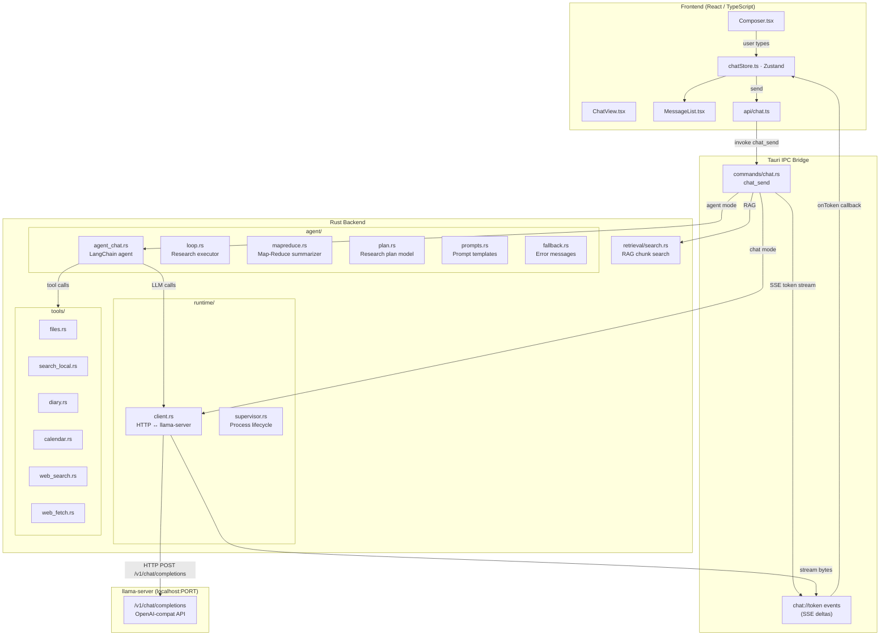
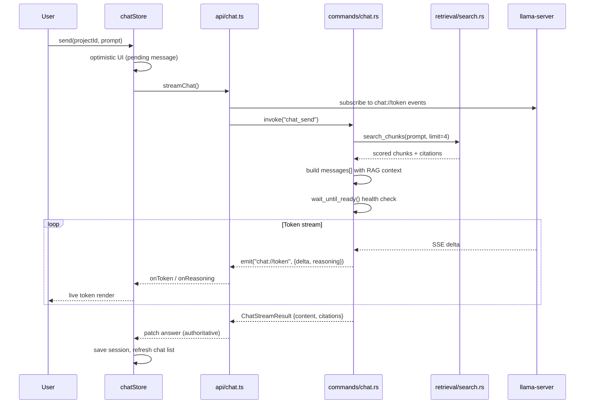
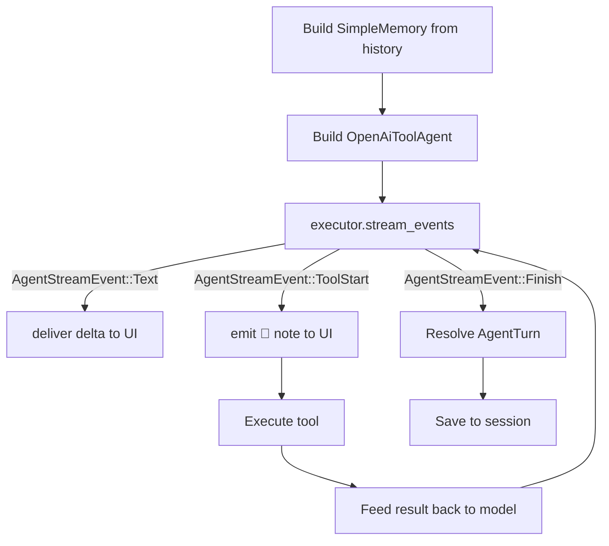
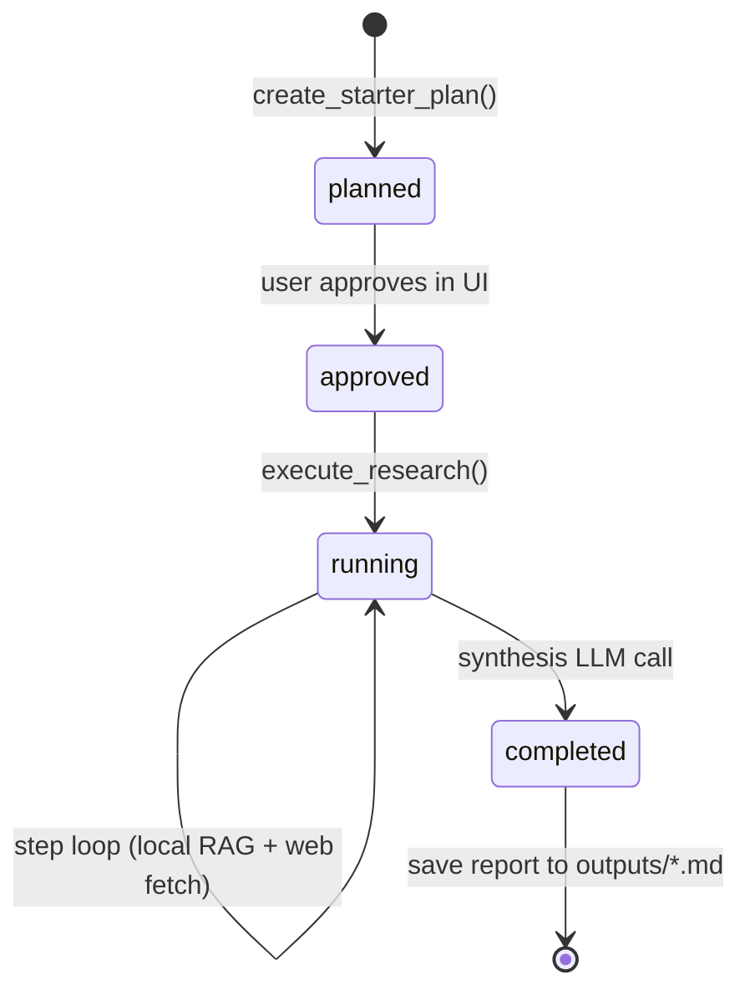

# Chat & Agent Backend Analysis — LocalAIse

## Architecture Overview

LocalAIse is a **Tauri desktop app** (React + Rust) that runs a local LLM entirely on-device via `llama.cpp`. All inference stays on `localhost`; there is no cloud fallback.



---

## Chat Pipeline (Normal Mode)

The full request lifecycle for a single chat turn:



### Key constants

| Constant | Value | Purpose |
|---|---|---|
| `RETRIEVAL_LIMIT` | 4 chunks | RAG context injected per turn |
| `HISTORY_LIMIT` | 12 turns | Bounded prompt replay |
| `READY_TIMEOUT` | 180 s | Health-poll before giving up |
| `RESPONSE_TIMEOUT` | 900 s | Max time for one completion |
| `temperature` | 0.2 | Fixed in non-agent LLM calls |

---

## Agent Mode (LangChain Tools Agent)

When a project is set to **Agent** mode, [`agent_chat.rs`](file:///d:/LocalAIse/src-tauri/src/agent/agent_chat.rs) runs a **LangChain `OpenAiToolAgentBuilder`** loop over the same local llama-server endpoint.

### Tool Set

| Tool | Backend helper | Condition |
|---|---|---|
| `read_file` | `tools::files::read_file` | Always |
| `list_files` | `tools::files::list_files` | Always |
| `write_file` | `tools::files::write_file` | Always (guarded by prompt) |
| `search_local` | `tools::search_local::search_local` | Always |
| `search_diary` | `tools::diary::search_diary` | Always |
| `list_events` | `tools::calendar::list_events_tool` | Always |
| `web_search` | `tools::web_search::search` | `internet_enabled = true` |
| `web_fetch` | `tools::web_fetch::fetch` | `internet_enabled = true` |

### Agent Loop



**Hard cap:** `MAX_TOOL_STEPS = 6` — after 6 tool rounds the agent is forced to answer, preventing infinite loops.  
**Note clipping:** Tool call annotations shown to the user are capped at `MAX_NOTE_CHARS = 80` chars.

### System Prompt Composition (Agent Mode)

```
<user's custom project prompt, or default>
↓ appended automatically ↓
AGENT RULES: You are in agent mode … [tool use instructions]
[internet line: on/off]
```

---

## Research Agent (Deep Research)

The research workflow lives in [`agent/loop.rs`](file:///d:/LocalAIse/src-tauri/src/agent/loop.rs) and is separate from the chat agent. It executes a [`ResearchPlan`](file:///d:/LocalAIse/src-tauri/src/agent/plan.rs):



**Plan structure** (auto-generated):
1. `local` — search indexed sources via RAG
2. `web` *(only if internet on)* — fetch Wikipedia-style URL
3. `synthesize` — LLM call to produce the final Markdown report

> [!NOTE]  
> Web steps currently use a hardcoded Wikipedia URL slug (`https://en.wikipedia.org/wiki/{slug}`). This is a placeholder — real web search goes through `network/gate.rs`.

---

## Map-Reduce Summarizer

[`mapreduce.rs`](file:///d:/LocalAIse/src-tauri/src/agent/mapreduce.rs) handles documents larger than the context window:

```
CHUNK_CHAR_LIMIT = 3,000 chars

Document ─► chunks[] ─► Map: summarize each chunk (concurrent LLM calls)
                        ─► Reduce: synthesize intermediate summaries into final report
```

Used by the analysis commands (`commands/files.rs`) for large file summarization.

---

## Streaming Architecture

Two separate channels keep the UI live during generation:

| Channel | Rust side | TS side |
|---|---|---|
| `chat://token` Tauri event | `app.emit("chat://token", {delta, reasoning})` | `subscribeChatTokens()` in `useStream.ts` |
| `invoke()` return value | `ChatStreamResult` | Authoritative final answer, replaces optimistic stream |

The **reasoning trace** (`<think>...</think>` or `reasoning_content` field in llama-server SSE) is a first-class concept:  
- Parsed in `client.rs` from `reasoning_content` or `reasoning` delta fields  
- Emitted separately with `reasoning: true`  
- Stored in `StoredMessage.reasoning`  
- Rendered as a collapsible `<details>` block in [`MessageList.tsx`](file:///d:/LocalAIse/src\components\chat\MessageList.tsx), hidden by `showThinking` toggle (persisted to `localStorage`)

---

## Session Persistence

Each project stores chats as JSON files in `<project>/.LocalAIse/chats/`:

```
chats/
  chat-001.json   ← { id, title, messages: [{ id, role, content, reasoning, citations, createdAt }] }
  chat-002.json
```

- `session_id = None` → new chat, fresh KV-cache (`cache_prompt: false`)
- `session_id = Some(id)` → continues saved session, KV-cache reuse allowed
- History is **windowed** to the last `HISTORY_LIMIT = 12` messages before being sent to the model

---

## GPU Fallback Behaviour

If the GPU server fails the health check (`wait_until_ready`), `commands/chat.rs` automatically:

1. Stops the GPU supervisor
2. Sets a fallback notice in the UI
3. Spawns a CPU-profile server (`ComputeDevice::Cpu`)
4. Retries the health check
5. If CPU also fails → marks state as failed and returns error

---

## Composer Capabilities

[`Composer.tsx`](file:///d:/LocalAIse/src\components\chat\Composer.tsx) is feature-rich beyond a basic textarea:

| Feature | Detail |
|---|---|
| File attachments | Text files + PDFs (pdf.js extracts text client-side) |
| Sampling controls | Temperature, Top-p, Top-k (UI state only; **not yet wired to the backend call**) |
| System prompt editor | Per-project custom system prompt, saved to project metadata |
| Cite-in-chat | Document viewer can queue a passage into the composer via `navStore.composerInsert` |
| Auto-resize textarea | `scrollHeight` capped at 180 px |

> [!WARNING]  
> The **sampling parameters** (temperature, top-p, top-k) in the Composer UI are stored in component state but are **not passed to `chat_send`**. The backend always uses a hardcoded `temperature: 0.2`. This is a gap between the UI and the actual inference call.

---

## Key Observations & Gaps

| # | Finding | Severity |
|---|---|---|
| 1 | Sampling params (temp, top-p, top-k) exist in Composer UI but are never sent to the Rust backend | 🟡 Medium |
| 2 | Research web steps use a hardcoded Wikipedia URL scheme — not a real search engine | 🟡 Medium |
| 3 | `MAX_TOOL_STEPS = 6` is a hard constant with no per-project override | 🟢 Low |
| 4 | Agent mode RAG context is built inside the LangChain chain (tool call), not pre-injected like chat mode | 🟢 Low |
| 5 | `complete_stream` rejects empty answers as errors — benign for safety but may surprise edge models | 🟢 Low |
| 6 | History window (`HISTORY_LIMIT = 12`) is a constant, not configurable per project | 🟢 Low |
