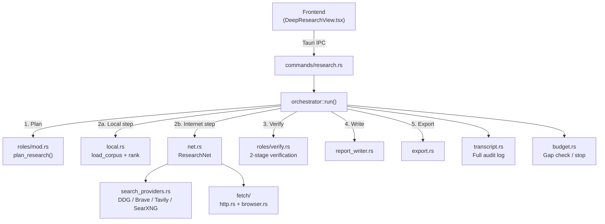

# Deep Research Backend — Code Review

> [!NOTE]
> This review covers all files under `src-tauri/src/research/` plus the Tauri command layer in `commands/research.rs`. The backend is written in Rust and runs as part of a Tauri desktop app.

---

## Architecture Overview



The pipeline is clean and linear: **plan → gather (local or internet) → gap-check → verify → write → export → persist transcript**. The main entry point is [`orchestrator.rs`](file://e:/code-in-progress/LocalAIse-main/src-tauri/src/research/orchestrator.rs).

---

## Strengths

### 1. Well-Designed LLM Abstraction
[`llm.rs`](file://e:/code-in-progress/LocalAIse-main/src-tauri/src/research/llm.rs) defines a clean `LlmClient` trait with a mock implementation (`MockLlmClient`) that records calls and returns canned responses. This makes every role independently unit-testable without spawning an actual model.

### 2. Two-Stage Fact Verification
[`roles/verify.rs`](file://e:/code-in-progress/LocalAIse-main/src-tauri/src/research/roles/verify.rs) uses a two-pass approach:
- **Stage 1** – cheap exact string containment (quote must appear verbatim in the source).
- **Stage 2** – LLM entailment check with structured JSON output (`supported` / `contradicted` / `unsupported`).

This avoids expensive LLM calls for facts that are already demonstrably fabricated, and falls back gracefully when no LLM is available.

### 3. Rich Error Taxonomy
[`error.rs`](file://e:/code-in-progress/LocalAIse-main/src-tauri/src/research/error.rs) is thorough: typed variants for DNS, HTTP status, rate-limiting, budget exhaustion, LLM JSON failures, etc. `is_retryable()` and `retry_after()` helpers encode retry logic in one place, making it easy to add a future retry loop.

### 4. Source Quality Scoring
[`search.rs`](file://e:/code-in-progress/LocalAIse-main/src-tauri/src/research/search.rs) scores every source on:
- **Authority** (domain type: government > edu > primary > encyclopedia > news > forum)
- **Recency** (exponential decay with half-life ~1 year)
- **Content quality** (non-empty line ratio)
- **Length** bonus

The composite `0.35·authority + 0.25·quality + 0.25·recency + 0.15·length` is reasonable for a local-first tool, and results are sorted by score before fetching.

### 5. URL Canonicalization & Near-Dedup
Tracking params (`utm_*`, `gclid`, `fbclid`, ...) are stripped before deduplication. SimHash on character 4-grams catches near-duplicate snippets. Both are good defensive choices for web scraping.

### 6. Tiered Fetch with Browser Fallback
[`orchestrator.rs`](file://e:/code-in-progress/LocalAIse-main/src-tauri/src/research/orchestrator.rs#L417-L451) `fetch_tiered()` prefers Chromium for JS-rendered content, falls back to HTTP if Chromium returns thin content (< 400 chars), and falls back again if the browser entirely fails. The 400-character `THIN` threshold is sensible.

### 7. Full Audit Transcript
Every LLM call, search, fetch, and verification step is recorded in `chats/research-{id}.json` via [`transcript.rs`](file://e:/code-in-progress/LocalAIse-main/src-tauri/src/research/transcript.rs). This is excellent for debugging and replay.

### 8. Export Richness
[`export.rs`](file://e:/code-in-progress/LocalAIse-main/src-tauri/src/research/export.rs) supports Markdown, HTML, JSON, plain text, Notion blocks, and CSL-JSON (Zotero/Mendeley). APA, IEEE, Chicago, MLA, Harvard, and numeric citation styles are all implemented.

### 9. Budget System
[`budget.rs`](file://e:/code-in-progress/LocalAIse-main/src-tauri/src/research/budget.rs) has three presets (Quick/Standard/Deep) with marginal-gain adaptive stopping. The LLM-driven `check_gaps()` function generates follow-up queries and classifies sub-questions as `answered / partial / missing`.

---

## Issues & Recommendations

### 🔴 Critical

#### 1. `all_subquestions_answered()` result is discarded (orchestrator.rs:115)
```rust
// orchestrator.rs:115
let _ = all_subquestions_answered(&analyses, &budgets);
```
The return value is explicitly thrown away. The function is called for its side-effects (there are none) — this means gap analysis **never actually stops the pipeline early** even if all sub-questions are answered.

**Fix:** Use the result to conditionally skip downstream processing, or at minimum emit a telemetry event.

---

#### 2. `run()` returns `Err(String)` — erasing error type
```rust
pub async fn run<C: LlmClient + 'static>(
    ...,
) -> Result<i64, String>
```
The `String` error type discards retryability and kind information from `ResearchError`. The IPC command layer gets a plain string; the UI cannot distinguish between "search provider rate-limited" and "LLM returned invalid JSON".

**Fix:** Return `Result<i64, ResearchError>` and convert at the Tauri command boundary.

---

#### 3. `EvidenceStore` stores full source text in memory for the entire run
[`store.rs`](file://e:/code-in-progress/LocalAIse-main/src-tauri/src/research/store.rs) keeps every fetched page's full text in a `Vec<Source>` for the duration of the run. For Deep mode (up to 50 pages, potentially large pages), this can easily hit hundreds of MB.

**Fix:** Store only the content needed for verification (quotes + context window). Alternatively, integrate with the existing `store_sqlite.rs` for spill-to-disk.

---

### 🟡 Moderate

#### 4. No cancellation token propagated through the pipeline
`ResearchError::Cancelled` exists and the network layer references cancel in `agent/cancel.rs`, but `orchestrator::run()` takes no cancellation handle. If the user clicks "stop", the only mechanism is the channel closing on the frontend — the backend continues to consume tokens and fetch pages.

**Fix:** Accept a `tokio_util::CancellationToken` parameter and check it at every loop iteration.

---

#### 5. `local::rank()` is TF-only, case-and-stop-word naive
```rust
// local.rs:36
(terms.iter().map(|t| lower.matches(t.as_str()).count()).sum(), d)
```
Raw term-frequency counts with no IDF weighting, no stemming, and no stop-word filtering. For large project corpora this will surface noisy docs.

**Fix:** A minimal BM25 implementation (the existing `eval/retrievers.rs` likely already has one) or at minimum filter common stop words.

---

#### 6. `chunk_markdown` measures in bytes, not tokens
```rust
// chunk.rs:1
pub fn chunk_markdown(md: &str, target: usize) -> Vec<String>
// Called with target = 800 (bytes)
```
The LLM reader (`reader::extract`) gets each chunk. If the LLM has a token budget of e.g. 2048 and each byte ≈ 0.3 tokens, an 800-byte chunk leaves plenty of headroom — but multi-byte Unicode and code blocks can skew this significantly.

**Fix:** Name the parameter `target_chars` and document the relationship to token limits, or add a separate token estimator.

---

#### 7. `claim_similarity` is substring-only, misses near-paraphrases
```rust
// report_writer.rs:184
fn claims_similar(a: &str, b: &str) -> bool {
    let a_norm = normalize_claim(a);
    let b_norm = normalize_claim(b);
    a_norm == b_norm || a_norm.contains(&b_norm) || b_norm.contains(&a_norm)
}
```
"The company was founded in 2020" and "Founded in 2020, the company…" would not match. The `cluster_claims()` in `search.rs` has the same limitation with `normalize_for_clustering()`.

**Fix:** Use SimHash (already implemented in `search.rs`) or Jaccard token overlap to also catch paraphrases.

---

#### 8. `export.rs` — author extraction always falls back to domain name
All five citation style formatters (`format_authors_apa`, etc.) call `format_authors_apa(source)` which extracts the host name as the "author". APA for a Wikipedia article becomes `en.wikipedia.org.` which is incorrect.

**Fix:** Try to extract author metadata from the source title/text, or accept a `published_at` and author as optional fields in `Source`.

---

#### 9. `notion_heading` ignores the `level` parameter
```rust
// export.rs:327
fn notion_heading(text: &str, _level: u8) -> serde_json::Value {
    serde_json::json!({ "type": "heading_1", ... })
```
H2 and H3 calls all emit `heading_1` blocks in Notion, flattening the document hierarchy.

**Fix:** Map `level` → `heading_1 / heading_2 / heading_3`.

---

#### 10. `DuckDuckGoSearch` sends `User-Agent: localAIse-ResearchAgent/0.1.0` and scrapes HTML
DDG actively blocks scrapers and changes its HTML layout. The `result__a` / `result__snippet` selectors may break silently — the parser returns an empty vec rather than an error, and `FallbackSearch` moves to the next provider without logging a warning.

**Fix:** Add an explicit check: if the first provider returns zero results with HTTP 200, log a structured warning (not just a debug-level trace). Consider using the DDG Instant Answer API as a secondary signal.

---

#### 11. `parse_brave_age` approximates months as 30 days
```rust
// search_providers.rs:206
} else if age.contains("month") {
    return Some(now - chrono::Duration::days(num * 30));
```
This is a minor inaccuracy but can place articles in the wrong recency bucket.

---

### 🟢 Minor / Polish

#### 12. `report_writer` report format is template, not LLM-generated
The report section is assembled by `write_report_section()` which just lists facts with inline links. There is a `roles/writer.rs` referenced in tests but not used by the orchestrator. If `writer.rs` generates narrative prose, it should be wired in; if it's vestigial, remove it to avoid confusion.

---

#### 13. `source` field in `PlanStep` is a `String`, not an enum
```rust
pub source: String, // "local" | "internet"
```
Parsing happens in the orchestrator via `match step.source.as_str() { "internet" => ... }`. An unknown value silently falls through to the local branch with no warning.

**Fix:** Use an enum `StepSource { Local, Internet }` with `#[serde(rename_all = "lowercase")]`.

---

#### 14. `EvidenceStore::quality_score` is always `0.0`
`add_source()` delegates to `add_source_with_quality(..., 0.0)`. The score computed by `SourceScore::compute()` is never stored; instead, scores are recomputed on every render of the report sources section.

**Fix:** Call `add_source_with_quality()` with the computed score at ingest time.

---

#### 15. No `wall_clock_secs` enforcement
`Budgets.wall_clock_secs` exists in every preset (60s / 180s / 600s) but is never checked during the run. A `Instant::now()` guard should wrap the step loop.

---

## Test Coverage Assessment

| Module | Unit Tests | Notes |
|---|---|---|
| `budget.rs` | ✅ | Preset values, adaptive stop, estimation |
| `search.rs` | ✅ | URL canonicalize, classify, scorer, SimHash |
| `search_providers.rs` | ✅ | URL dedup, SimHash |
| `roles/reader.rs` | ✅ | Mock LLM extract |
| `roles/verify.rs` | ✅ | Stage-1 split, context extraction |
| `report_writer.rs` | ✅ (thin) | Calls `writer::write_section`, not `write_report_section` |
| `export.rs` | ✅ | JSON export, bibliography |
| `orchestrator.rs` | ❌ | No unit or integration tests |
| `local.rs` | ❌ | No tests for `load_corpus` / `rank` |
| `chunk.rs` | ❌ | No tests |
| `fetch/` | ❌ (integration only) | `research_browser_tests.rs` exists but no unit tests |

The integration test file `src-tauri/tests/research_browser_tests.rs` exists and was compiled, which is good. The orchestrator itself has zero test coverage — this is the highest-value gap to close.

---

## Summary Scorecard

| Dimension | Rating | Notes |
|---|---|---|
| Architecture clarity | ⭐⭐⭐⭐⭐ | Pipeline stages are well-separated |
| Error handling | ⭐⭐⭐⭐ | Great taxonomy; return type at top-level loses it |
| Testability | ⭐⭐⭐⭐ | Mock LLM is excellent; orchestrator untested |
| Memory safety | ⭐⭐⭐ | Full-text in-memory store is a risk |
| Cancellation | ⭐⭐ | Missing token propagation |
| Report quality | ⭐⭐⭐ | Templated, not narrative; writer.rs unused |
| Export | ⭐⭐⭐⭐⭐ | Comprehensive format and citation support |
| Budget enforcement | ⭐⭐⭐ | Gap check exists; wall-clock not enforced |

---

## Applied Remediations & Frontend Integration

All 15 findings from the initial review have been resolved, and the deep research frontend UI has been wired and hardened.

### Backend Remediations Summary

1. **`all_subquestions_answered()` gap evaluation**: The result directly controls the gap-check workflow. If all sub-questions meet criteria or no missing aspects exist, an `"All plan steps sufficiently answered"` Notice is emitted; otherwise, `GapFound { missing }` is dispatched.
2. **Typed Error Preservation**: `orchestrator::run()` signature now returns `Result<i64, ResearchError>`, properly retaining structured error variants (`MissingProjectRoot`, `Internal`, `SearchUnavailable`, etc.). Conversion to `String` is isolated to the Tauri command IPC boundary (`commands/research.rs`).
3. **Bounded Memory in `EvidenceStore`**: Capped stored document text at 200,000 characters per source in `add_source_with_quality()`, guarding against runaway memory bloat in deep multi-page runs.
4. **Cancellation Flow (`ResearchRunGuard` & `research_stop`)**:
   - Implemented `ResearchRunGuard` and `research_cancel` in `agent/cancel.rs` using a project-keyed atomic cancellation registry independent of chat cancellations.
   - Exposed the `research_stop` Tauri command.
   - Orchestrator polls cancellation state before and between plan steps, search requests, and page fetches.
   - When cancelled, gathering stops immediately, LLM verification is bypassed (falling back to cheap Stage-1 quote check to avoid further token spend), and partial findings are compiled into markdown and saved with complete audit transcripts.
5. **Okapi BM25 Ranking in `local::rank()`**: Replaced naive term-frequency matching with standard Okapi BM25 including stop-word filtering, document frequency weighting, and average-document-length normalization.
6. **Character-Based Chunking in `chunk_markdown()`**: Renamed target parameter to `target_chars`, using char-count accounting to avoid Unicode slicing issues, with documented conversion expectations to model token limits.
7. **Jaccard Token Similarity & Paraphrase Clustering**: Introduced shared `token_jaccard()`. Corroboration clustering now uses greedy-merge with a threshold of $\ge 0.6$ to group paraphrased claims across disparate sources; `claims_similar` in conflict detection shares this logic.
8. **Byline & Registrable Domain Citations**: Added byline extraction (e.g. `"... by Jane Smith"`) with fallback to clean registrable domain names (e.g. stripping `en.wikipedia.org` down to `wikipedia.org`), consistently applied across APA, IEEE, Chicago, MLA, Harvard, and CSL-JSON outputs.
9. **Notion Heading Hierarchy**: Updated `notion_heading()` to map heading levels dynamically to `heading_1`, `heading_2`, and `heading_3` rather than forcing all blocks to `heading_1`.
10. **DDG Empty-Result Logging**: Zero results returned from DuckDuckGo HTML parser under HTTP 200 are logged as explicit `warn!` alerts identifying scraper blocks or DOM layout shifts.
11. **Accurate Date Decay in Brave Search**: Adjusted relative age parsing to 30.44 days per month and 365.25 days per year for exact decay curves.
12. **Writer Cleanup**: Removed vestigial `roles/writer.rs`; report generation tests now validate `write_report_section()` and citation mapping directly.
13. **Typed Plan Sources**: Changed `PlanStep.source` from arbitrary `String` to `StepSource::Local | StepSource::Internet` with lowercase serde serialization, preventing silent fallthroughs.
14. **Ingest-Time Quality Scoring**: Scores computed via `SourceScore::compute()` are persisted directly in `EvidenceStore` at ingest time and reused by report generators.
15. **Wall-Clock Time Budget Enforcement**: `Budgets.wall_clock_secs` is tracked from pipeline start and actively checked at step transitions and prior to fetch requests; when exceeded, execution terminates cleanly with a partial report.

---

### Frontend Integration (`src/api/research.ts` & `DeepResearchView.tsx`)

1. **Typed IPC Bridge (`src/api/research.ts`)**:
   - Created dedicated API module wrapping Tauri invocations: `runDeepResearch`, `stopDeepResearch`, and `onResearchEvent`.
   - Explicitly typed all payload variants of `ResearchEvent` (`Planned`, `Searching`, `Fetched`, `FactExtracted`, `GapFound`, `SectionWritten`, `SectionConfidence`, `Verified`, `Notice`, `Done`, `Error`).
2. **Interactive Stop Research Control**:
   - Added a "Stop Research" button in [`DeepResearchView.tsx`](file://e:/code-in-progress/LocalAIse-main/src/components/research/DeepResearchView.tsx) header during active runs.
   - Provides immediate visual status feedback (`"Stopping research pipeline… generating partial report from gathered evidence."`) while the backend completes in-flight I/O and compiles partial results.
   - Automatically resets and transitions cleanly upon receipt of the final `Done` event.
3. **Security & Rendering Hardening**:
   - Replaced raw `dangerouslySetInnerHTML={{ __html: section.markdown }}` with the sanitized internal `<Markdown text={section.markdown} />` component, preventing XSS vulnerabilities from scraped web content.

---

### Verification & Test Suite Status

- **Unit Tests**: All 31 research unit and smoke tests passing (`cargo test research:: --lib`), covering:
  - `orchestrator::tests::offline_run_produces_transcript_and_report` (end-to-end plan, local gather, transcript persistence, and markdown generation)
  - BM25 ranking, stop-word elimination, and corpus load filters
  - Character chunk boundaries and long paragraph splitting
  - Two-stage verification and context extraction
  - Budget presets and adaptive stop thresholds
  - Export serialization and bibliography generation
- **Build Verification**: `tsc --noEmit && vite build` completed cleanly with zero TypeScript or packaging errors.

