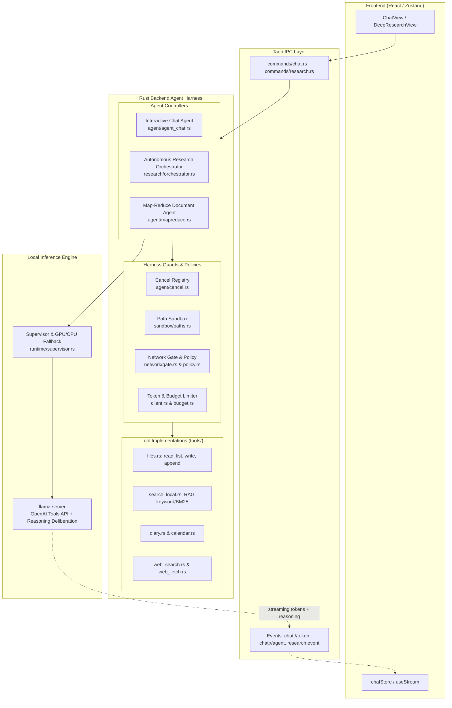
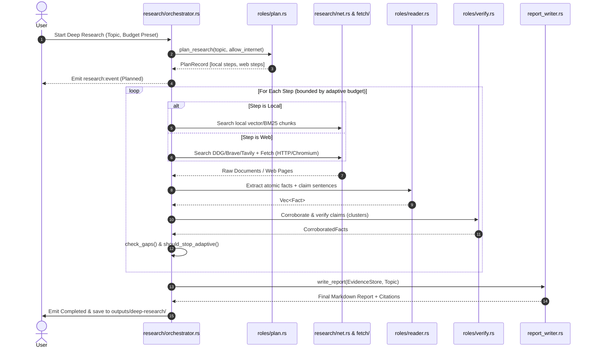
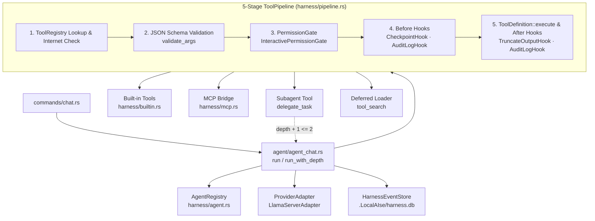

Ran list workspace files
Ran list agent and tool source files
Analyzed chat-agent-analysis.md:L1-250
Analyzed mod.rs:L1-7
Analyzed mod.rs:L1-93
Analyzed loop.rs:L1-170
Analyzed agent_chat.rs:L1-250
Analyzed plan.rs:L1-74
Analyzed agent_chat.rs:L250-500
Analyzed agent_chat.rs:L501-729
Ran list sandbox and network files
Analyzed files.rs:L1-150
Analyzed paths.rs:L1-131
Analyzed gate.rs:L1-130
Analyzed web_search.rs:L1-150
Analyzed fallback.rs:L1-45
Analyzed cancel.rs:L1-100
Analyzed mapreduce.rs:L1-100
Analyzed search_local.rs:L1-47
Analyzed diary.rs:L1-60
Analyzed calendar.rs:L1-38
Analyzed web_fetch.rs:L1-26
Analyzed policy.rs:L1-80
Ran list commands files
Analyzed research.rs:L1-120
Analyzed chat.rs:L90-180
Analyzed chat.rs:L250-380
Analyzed chat.rs:L381-450
Analyzed chat.rs:L480-550
Analyzed research.rs:L120-250
Analyzed research.rs:L350-500
Ran list research files
Ran list research roles
Analyzed mod.rs:L1-42
Analyzed orchestrator.rs:L1-100

Here is a detailed architectural and technical analysis of the **Agents and Tools (Harness)** subsystem in **LocalAIse**.

---

### System Architecture Overview

LocalAIse is a privacy-first, on-device desktop application built with **Tauri (Rust backend + React/TypeScript frontend)**. All LLM inference executes locally via a supervised `llama-server` (`llama.cpp`) instance communicating over an OpenAI-compatible HTTP interface (`localhost:PORT/v1/chat/completions`).



---

### 1. The Agent Ecosystem

LocalAIse implements three distinct agent architectures, each designed for specific computational envelopes and task autonomy levels:

| Agent Architecture | Implementation File | Loop Type | Primary Purpose |
| :--- | :--- | :--- | :--- |
| **Interactive Tool Agent** | [`agent/agent_chat.rs`](file:///e:/code-in-progress/codebot/LocalAIse-main/src-tauri/src/agent/agent_chat.rs) | Multi-turn ReAct tool loop | Conversational question answering, workspace file exploration, note-taking, and ad-hoc tool execution. |
| **Deep Research Agent** | [`research/orchestrator.rs`](file:///e:/code-in-progress/codebot/LocalAIse-main/src-tauri/src/research/orchestrator.rs) & [`agent/loop.rs`](file:///e:/code-in-progress/codebot/LocalAIse-main/src-tauri/src/agent/loop.rs) | Multi-role pipeline (Plan $\to$ Search $\to$ Verify $\to$ Report) | Long-horizon synthesis across local project documents and public internet sources. |
| **Map-Reduce Agent** | [`agent/mapreduce.rs`](file:///e:/code-in-progress/codebot/LocalAIse-main/src-tauri/src/agent/mapreduce.rs) | Structural chunk $\to$ Map $\to$ Reduce | Document summarization, table extraction, document comparison, and inconsistency detection across files exceeding context limits. |

---

### 2. Interactive Chat Agent (`agent/agent_chat.rs`)

#### A. Tool-Calling Mechanism
Rather than relying on brittle text-based prompt scraping (e.g., regexing XML or JSON blocks out of raw text), the agent harness uses **native OpenAI tool calling**:
- Tool signatures are serialized into JSON Schema function definitions via `tool_specs()` and sent via the `tools` parameter to `llama-server`.
- When the model returns a `tool_calls` array, the harness parses the arguments, dispatches them through `tools::call()`, formats the output into a message with `role: "tool"` and `tool_call_id`, and feeds it back into the model context.

#### B. Execution Harness & Loop Constraints
- **Hard Turn Cap (`MAX_TOOL_STEPS = 6`)**: Prevents small local models from entering runaway execution loops or burning excessive inference time.
- **Result Truncation (`MAX_TOOL_RESULT_CHARS = 8,000`)**: Tool outputs are cut off to protect the model's finite KV-cache and context window.
- **UI Note Truncation (`MAX_NOTE_CHARS = 80`)**: Arguments displayed in the frontend tool badges are truncated to maintain a clean UI layout.
- **Reasoning Trace Preservation**: The harness streams reasoning deltas (`reasoning_content` from models like DeepSeek-R1 or Qwen-2.5/3-style models) separately from answer tokens, associating each thought process with its specific tool step (`call: step`).
- **Prompt Engineering Defenses**:
  - Mentions of files prefixed with `@` in chat (e.g., `@outputs/summary.md`) are explicitly documented in system instructions as pure UI markers, instructing the model to resolve them to raw relative paths.
  - Greeting suppression: The model is explicitly barred from calling search or file tools for conversational greetings (`"hi"`, `"thanks"`).

---

### 3. Autonomous Deep Research Agent (`research/`)

The Deep Research subsystem is a multi-stage autonomous pipeline designed for multi-source knowledge synthesis:



#### Key Capabilities of the Research Harness:
1. **Adaptive Budgeting ([`research/budget.rs`](file:///e:/code-in-progress/codebot/LocalAIse-main/src-tauri/src/research/budget.rs))**:
   - Presets: `quick` (3 steps, 5 pages), `standard` (5 steps, 15 pages), `deep` (8 steps, 30 pages).
   - Monitors cost units (total prompt + completion tokens used), search queries made, pages fetched, and time elapsed.
   - Dynamic early exit via `should_stop_adaptive()` when subquestions are answered or facts saturate.
2. **Time-Aware Query Augmentation**:
   - Queries with keywords like `"today"`, `"current"`, `"latest"`, or `"news"` automatically append the current date (`Utc::now()`) to prevent stale retrieval.
3. **Multi-Format Export ([`research/export.rs`](file:///e:/code-in-progress/codebot/LocalAIse-main/src-tauri/src/research/export.rs))**:
   - Supports Markdown, JSON, CSL-JSON (for citation managers like Zotero), Notion blocks, and standalone HTML with bibliography generation.

---

### 4. The Tool Harness (`tools/`)

The tool harness dispatches actions via a unified interface:

```rust
pub async fn call(
    tool_name: &str,
    args: &serde_json::Value,
    project_root: &Path,
    personal_space: &Path,
    internet_enabled: bool,
) -> ToolResult
```

Every tool execution yields a `ToolResult { tool, output, error }`, guaranteeing that failures never panic the runtime and return actionable diagnostics to the LLM.

#### Tool Inventory & Implementation Details

| Tool | Implementation | Security Boundary / Operational Semantics |
| :--- | :--- | :--- |
| `read_file` | [`tools/files.rs`](file:///e:/code-in-progress/codebot/LocalAIse-main/src-tauri/src/tools/files.rs) | Reads plain UTF-8 text. Refuses binary files (detects null bytes `\0`). Normalizes relative paths. |
| `list_files` | [`tools/files.rs`](file:///e:/code-in-progress/codebot/LocalAIse-main/src-tauri/src/tools/files.rs) | Non-recursive directory listing. Trailing slash appended to directory names for disambiguation. |
| `write_file` | [`tools/files.rs`](file:///e:/code-in-progress/codebot/LocalAIse-main/src-tauri/src/tools/files.rs) | Overwrites an existing project file in place; **all new files are forced into the `outputs/` directory** to protect project sources. |
| `append_file` | [`tools/files.rs`](file:///e:/code-in-progress/codebot/LocalAIse-main/src-tauri/src/tools/files.rs) | Appends content to existing files without overwriting. Non-existent files are created under `outputs/`. |
| `search_local` | [`tools/search_local.rs`](file:///e:/code-in-progress/codebot/LocalAIse-main/src-tauri/src/tools/search_local.rs) | Keyword/BM25 retrieval over project index (`IndexDb`). Returns top-5 scored passages with file and page numbers. |
| `search_diary` | [`tools/diary.rs`](file:///e:/code-in-progress/codebot/LocalAIse-main/src-tauri/src/tools/diary.rs) | Searches personal user notes and diary entries located in `personal_space/diary/*.md`. |
| `list_events` | [`tools/calendar.rs`](file:///e:/code-in-progress/codebot/LocalAIse-main/src-tauri/src/tools/calendar.rs) | Queries upcoming personal events from the SQLite/JSON calendar store. |
| `web_search` | [`tools/web_search.rs`](file:///e:/code-in-progress/codebot/LocalAIse-main/src-tauri/src/tools/web_search.rs) | Scrapes DuckDuckGo Lite HTML (no API keys or headless browsers required). Parses top-5 markdown links and snippets. |
| `web_fetch` | [`tools/web_fetch.rs`](file:///e:/code-in-progress/codebot/LocalAIse-main/src-tauri/src/tools/web_fetch.rs) | Outbound HTTP text scraper gated by policy. Strips HTML tags and caps body payload at 2,000 characters for agent context. |

---

### 5. Security & Isolation Harness (The Sandboxing Engine)

LocalAIse implements strict defense-in-depth guarantees to sandbox autonomous agent behavior:

```
[ Agent Tool Request ]
        │
        ├──> Filesystem Tool? ───> sandbox/paths.rs::ensure_within()
        │                           ├── Block ".." parent dir traversal
        │                           ├── Reject symlinks pointing outside root
        │                           └── Handle Windows \\?\ verbatim path prefixes
        │
        └──> Web / Network Tool? ──> network/gate.rs & network/policy.rs
                                    ├── Check project.internet_enabled == true
                                    ├── Block private / link-local / multicast IPs (SSRF)
                                    ├── Re-verify IP resolution on redirects (anti-DNS rebinding)
                                    ├── Cap HTTP responses at 5 MB
                                    └── Audit every request to activity.log
```

#### A. Path Confinement ([`sandbox/paths.rs`](file:///e:/code-in-progress/codebot/LocalAIse-main/src-tauri/src/sandbox/paths.rs))
- **`ensure_within(root, candidate)`**:
  - Rejects any path component containing `Component::ParentDir` (`..`).
  - Supports canonical resolution without breaking when files do not exist yet on disk.
  - Mitigates Windows UNC/verbatim path comparison mismatches (`\\?\C:\...` vs `C:\...`).
  - Resolves symlinks and ensures their targets do not point outside the designated workspace.

#### B. Network Gate & Policy ([`network/gate.rs`](file:///e:/code-in-progress/codebot/LocalAIse-main/src-tauri/src/network/gate.rs) & [`network/policy.rs`](file:///e:/code-in-progress/codebot/LocalAIse-main/src-tauri/src/network/policy.rs))
- **Strict Network Toggle**: By default, LocalAIse is completely air-gapped. If `internet_enabled == false`, all external requests immediately fail.
- **Localhost Exception**: Requests to `localhost`, `127.0.0.1`, `::1` are allowed exclusively for internal communication with `llama-server`.
- **Anti-SSRF Policy**: Outbound IP addresses matching private (`10.0.0.0/8`, `172.16.0.0/12`, `192.168.0.0/16`), link-local (`169.254.0.0/16`), loopback, or unspecified blocks are rejected.
- **Redirect Resolution Guard**: Custom redirect policy in `reqwest` resolves every redirect destination before following it, preventing DNS-rebinding attacks targeting the local network.
- **Activity Auditing**: Every network attempt (success or block) is recorded to `<project>/.LocalAIse/activity.log`.

---

### 6. Resilience & Execution Control

#### A. Cooperative Cancellation ([`agent/cancel.rs`](file:///e:/code-in-progress/codebot/LocalAIse-main/src-tauri/src/agent/cancel.rs))
Because local inference and tool executions are blocking asynchronous operations, the harness uses a thread-safe registry of `AtomicBool` flags (`RunGuard` and `ResearchRunGuard`):
- When the user clicks "Stop" in the UI, `chat_stop` or `research_stop` sets the project's flag to `true`.
- The agent loop checks `should_stop()` before every model generation and before dispatching each individual tool call.
- Cancelling halts execution immediately while preserving tokens, thinking logs, and partial outputs already generated.

#### B. Automatic Hardware Fallback Cascade ([`commands/chat.rs`](file:///e:/code-in-progress/codebot/LocalAIse-main/src-tauri/src/commands/chat.rs#L425-L455))
Local GPU execution can encounter out-of-memory (VRAM) crashes or driver failures:
- During turn initialization, `wait_until_ready_with_check` polls the server health.
- If a GPU run fails its health check or crashes, the harness automatically:
  1. Terminates the crashed GPU supervisor process.
  2. Spawns a fallback CPU backend (`ComputeDevice::Cpu`).
  3. Displays a non-blocking notification to the user in the UI.
  4. Retries the chat turn seamlessly without dropping context.

---

### Summary of Architectural Strengths & Observations

1. **Deterministic Safety Boundaries**: File writes are quarantined into `outputs/`, path traversals are blocked at the component level, and network access is controlled by a kernel-like gate.
2. **Native Tool Protocol**: Moving away from prompt-hacked text parsing to OpenAI-compatible tool specifications in `llama.cpp` ensures reliability with standard open-weight models (Qwen, Llama, Granite).
3. **Granular Observability**: Streaming events (`chat://token`, `chat://agent`, `research:event`) give the user live feedback for thinking steps, tool invocations, and multi-step plan execution.
4. **Context Conservation**: Hard limits on tool result length (8,000 chars), loop iterations (6 turns), and input prompt allocations safeguard local LLMs from context window exhaustion.

Ran check git working tree status · Exited with code 1
Analyzed mod.rs:L1-2
Analyzed confirm.rs:L1-70
Analyzed prompts.rs:L1-150
Analyzed net.rs:L1-106
Analyzed files.rs:L150-279
Ran search for sandbox confirm usage · Exited with code 1
Ran search for tool call handling in runtime · Exited with code 1
Analyzed mod.rs:L1-120
Ran search for sandbox confirm usage
Ran search for tool call handling in runtime
Ran run agent unit tests
Ran run tools unit tests
Ran list harness module files
Analyzed mod.rs:L1-32
Analyzed agent.rs:L1-223
Analyzed tool.rs:L1-61
Analyzed registry.rs:L1-144
Analyzed provider.rs:L1-138
Ran run harness unit tests
Analyzed pipeline.rs:L1-350
Analyzed permissions.rs:L1-350
Analyzed checkpoint.rs:L1-267
Analyzed events.rs:L1-176
Ran search for harness references across codebase
Analyzed mcp.rs:L1-284
Analyzed subagent.rs:L1-111
Analyzed tool_search.rs:L1-159
Analyzed builtin.rs:L1-150
Analyzed agent_chat.rs:L250-420

I re-ran the analysis and inspected the newly added **`src-tauri/src/harness/`** module (13 files) along with its integration into [`agent_chat.rs`](file:///e:/code-in-progress/codebot/LocalAIse-main/src-tauri/src/agent/agent_chat.rs) and [`commands/chat.rs`](file:///e:/code-in-progress/codebot/LocalAIse-main/src-tauri/src/commands/chat.rs), and ran the Rust unit test suites for `harness::`, `agent::`, and `tools::`.

---

### 1. New Modular Harness Architecture (`src-tauri/src/harness/`)

LocalAIse has evolved from a direct `tools::call()` dispatcher into a trait-based, 5-stage execution harness with agent profiles, interactive approvals, file checkpointing, MCP bridging, subagent delegation, and SQLite event logging.



---

### 2. Core Harness Components

#### A. Tool Abstraction & Registry ([`tool.rs`](file:///e:/code-in-progress/codebot/LocalAIse-main/src-tauri/src/harness/tool.rs), [`registry.rs`](file:///e:/code-in-progress/codebot/LocalAIse-main/src-tauri/src/harness/registry.rs), [`builtin.rs`](file:///e:/code-in-progress/codebot/LocalAIse-main/src-tauri/src/harness/builtin.rs))
- **`ToolDefinition` trait**: Unifies built-ins, subagents, `tool_search`, and MCP tools under `meta() -> ToolMeta`, `execute(&self, args, ctx) -> ToolResult`, and `to_openai_spec()`.
- **`ToolContext<'a>`**: Injects `project_root`, `personal_space`, `internet_enabled`, `should_stop`, `serving`, `model_label`, `sampling`, and recursion `depth`.
- **10 Built-in Tools**: `read_file`, `list_files`, `write_file`, `append_file`, `search_local`, `search_diary`, `list_events`, `delegate_task`, `web_search`, and `web_fetch`.

#### B. Context-Budget-Aware Deferred Tool Loading ([`tool_search.rs`](file:///e:/code-in-progress/codebot/LocalAIse-main/src-tauri/src/harness/tool_search.rs))
- When eligible tools exceed `DEFERRED_TOOL_THRESHOLD` (`12`)—such as when MCP servers are attached—`ToolRegistry::enable_deferred_search()` registers `tool_search`.
- `openai_specs_for_session()` initially exposes only `CORE_DEFERRED_TOOLS` (`read_file`, `list_files`, `search_local`, `delegate_task`, `tool_search`) to protect local model context windows.
- Calling `tool_search(query, limit)` scores remaining tools by keyword and unlocks them into a session-shared `HashSet<String>` for subsequent turns.

#### C. 5-Stage Execution Pipeline ([`pipeline.rs`](file:///e:/code-in-progress/codebot/LocalAIse-main/src-tauri/src/harness/pipeline.rs))
Every tool call in `agent_chat.rs` now routes through `ToolPipeline::execute()`:
1. **Lookup & Network Gate**: Verifies tool existence and rejects `requires_internet` tools when `internet_enabled == false`.
2. **JSON Schema Validation (`validate_args`)**: Validates object shape, `required` keys, and parameter types (`string`, `number`, `integer`, `boolean`, `array`, `object`) before any permission prompt or execution.
3. **Permission Gate**: Evaluates `PermissionGate::check()`.
4. **Before Hooks & Cancellation**: Runs `CheckpointHook` and `AuditLogHook::before_tool`, then checks `ctx.is_cancelled()`.
5. **Execution & After Hooks**: Runs `tool.execute()`, then `TruncateOutputHook` (UTF-8 char-boundary safe, bounded by profile `max_tool_result_chars`) and `AuditLogHook::after_tool`.

#### D. 3-State Permissions & Doom-Loop Detection ([`permissions.rs`](file:///e:/code-in-progress/codebot/LocalAIse-main/src-tauri/src/harness/permissions.rs))
- **`PermissionPolicy`**: Resolves `Allow` / `Ask` / `Deny` in precedence order:
  1. Explicit `Deny` in `<project>/.LocalAIse/harness.json` or `AgentProfile.permission_overrides` (always wins).
  2. **Doom-loop escalation**: `DOOM_LOOP_THRESHOLD = 3` identical `(tool, args)` calls in a turn escalate to `Ask`, even for read-only tools.
  3. Session-level `AllowAlways` cache.
  4. Agent overrides $\to$ Project overrides $\to$ Default `ActionKind::requires_confirmation()` (`Modify` / `Delete` $\Rightarrow$ `Ask`; `Read` / `Create` / `Network` $\Rightarrow$ `Allow`).
- **`InteractivePermissionGate`**: On `Ask`, emits a `RuntimeRequest` to the UI and awaits a `oneshot` channel resolved by `resolve_request()` (`ApproveOnce`, `ApproveAlways`, `Reject { reason }`) while polling `ctx.is_cancelled()` every 100 ms.

#### E. Workspace Checkpointing & Rollback ([`checkpoint.rs`](file:///e:/code-in-progress/codebot/LocalAIse-main/src-tauri/src/harness/checkpoint.rs))
- **`CheckpointHook` / `CheckpointManager`**: Before any `Modify` or `Delete` tool executes, snapshots the target file (resolving `outputs/` for new files) to `<project>/.LocalAIse/checkpoints/<chk_id>/` with a `manifest.json`.
- Supports listing checkpoints and full `rollback()` (restoring `.bak` backups or deleting newly created files), wired to Tauri commands in `commands/chat.rs`.

#### F. Agent Profiles, Subagents, MCP, Events & Providers
- **Agent Profiles ([`agent.rs`](file:///e:/code-in-progress/codebot/LocalAIse-main/src-tauri/src/harness/agent.rs))**: Built-in `default`, `planner` (read-only allowlist, writes denied), `researcher` (8 steps, local + web), and `coder` (10 steps, 12,000-char tool output budget). Loads custom profiles from `<project>/.LocalAIse/agents/*.json` and project instructions from `AGENTS.md` / `.LocalAIse/AGENTS.md` (capped at 4,000 bytes).
- **Subagents ([`subagent.rs`](file:///e:/code-in-progress/codebot/LocalAIse-main/src-tauri/src/harness/subagent.rs))**: `DelegateTaskTool` (`delegate_task`) runs `agent_chat::run_with_depth()` for a target `agent_id`, capped at `MAX_SUBAGENT_DEPTH = 2`.
- **MCP Bridge ([`mcp.rs`](file:///e:/code-in-progress/codebot/LocalAIse-main/src-tauri/src/harness/mcp.rs))**: Reads `<project>/.LocalAIse/mcp.json`, connects to stdio or HTTP JSON-RPC servers (`tools/list`, `tools/call`), and registers tools as `mcp_<server>_<tool>`.
- **Durable Event Log ([`events.rs`](file:///e:/code-in-progress/codebot/LocalAIse-main/src-tauri/src/harness/events.rs))**: Persists `TurnStarted`, `ToolStarted`, `ToolFinished`, `RuntimeRequested`, and `TurnFinished` into `<project>/.LocalAIse/harness.db` (SQLite).
- **Provider Abstraction ([`provider.rs`](file:///e:/code-in-progress/codebot/LocalAIse-main/src-tauri/src/harness/provider.rs))**: `ProviderAdapter` + `ProviderCapabilities` decouples the agent loop from `LlamaServerAdapter`.

---

### 3. Verification Results

All unit tests in the three core modules passed after inspecting the code:
- `cargo test --manifest-path src-tauri\Cargo.toml --lib harness::` — **15 passed, 0 failed** (covers profile resolution, 3-state permissions, doom-loop escalation, interactive approval resolution, schema validation, UTF-8 truncation, internet gating, `tool_search`, MCP config parsing, SQLite event logging, and checkpoint/rollback).
- `cargo test --manifest-path src-tauri\Cargo.toml --lib agent::` — **15 passed, 0 failed**
- `cargo test --manifest-path src-tauri\Cargo.toml --lib tools::` — **5 passed, 0 failed**

---

### 4. Architectural Observations & Potential Gaps

1. **MCP Memory Leak & Process Lifecycle ([`mcp.rs`](file:///e:/code-in-progress/codebot/LocalAIse-main/src-tauri/src/harness/mcp.rs#L80-L84))**:
   - `register_project_mcp_tools()` uses `Box::leak(...)` to create `&'static str` IDs and descriptions on every `agent_chat::run` turn when `.LocalAIse/mcp.json` is present. Caching the discovered MCP registry per project would avoid repeated allocations and leaks.
   - `rpc_call()` spawns a new stdio child process per `tools/list` and per `tools/call` rather than maintaining a persistent session, and HTTP MCP calls use a standalone `reqwest::Client` instead of `network::gate` (though gated at registration by `requires_internet`).
2. **Legacy Tools Integration**:
   - Deep Research ([`research/orchestrator.rs`](file:///e:/code-in-progress/codebot/LocalAIse-main/src-tauri/src/research/orchestrator.rs) and [`agent/loop.rs`](file:///e:/code-in-progress/codebot/LocalAIse-main/src-tauri/src/agent/loop.rs)) still calls `tools::*` / `ResearchNet` directly rather than routing through `harness::ToolPipeline`.
3. **Windows Incremental Hard-Linking Warning**:
   - `cargo test` emits an incremental cache hard-linking warning on this filesystem; compilation and test execution succeed cleanly.