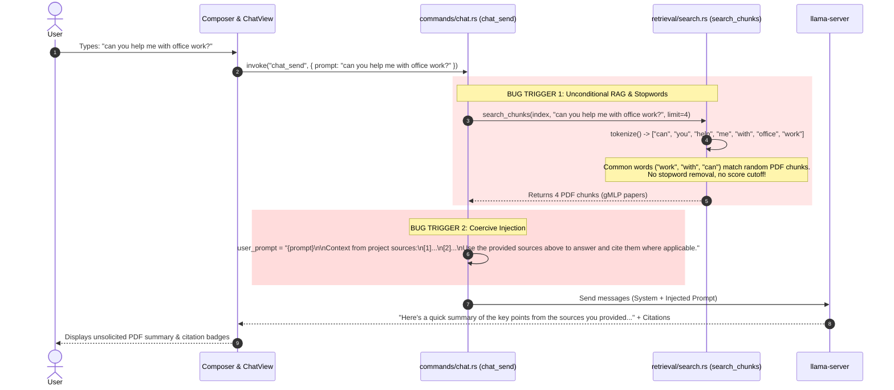

# Bug Analysis: Unsolicited PDF Retrieval and Citation in Chat Backend

## Executive Summary

When a user submits a general conversational greeting or query (e.g., *"can you help me with office work?"*), the assistant unexpectedly returns a detailed summary of indexed research PDFs (e.g., gMLP papers `2105.08050v2.pdf`, `1503.02531v1.pdf`) and appends citations, despite the user never requesting or uploading those documents.


This issue stems from **unconditional eager RAG injection**, **stopword pollution**, **absence of relevance thresholding**, and a **coercive prompt directive**.

---

## Architecture Flow of the Bug



---

## Detailed Root Cause Breakdown

### 1. Zero Query Intent Classification & Unconditional Retrieval
In [`commands/chat.rs` (lines 87–112)](file:///d:/LocalAIse/src-tauri/src/commands/chat.rs#L87-L112), **every single user message** in Chat Mode immediately triggers a project index search, regardless of whether the prompt is a general question, a greeting, or an explicit inquiry about project files:

```rust
// commands/chat.rs lines 87-93
let index_db = crate::index::db::IndexDb::new(&record.path);
let project_index = index_db.load();
let scored_chunks = crate::retrieval::search::search_chunks(&project_index, &prompt, RETRIEVAL_LIMIT);
let citations = crate::retrieval::search::format_citations(&scored_chunks);
```

There is **no check** for:
- Explicit file uploads / attachments (`attachedFiles` in composer).
- User intent (conversational vs. factual project lookup).
- Scope targeting (e.g. `@filename` or explicit document references).

---

### 2. Stopword Pollution in Tokenizer
In [`retrieval/search.rs` (lines 13–20)](file:///d:/LocalAIse/src-tauri/src/retrieval/search.rs#L13-L20):

```rust
fn tokenize(text: &str) -> Vec<String> {
    text.to_lowercase()
        .split(|c: char| !c.is_alphanumeric())
        .filter(|t| t.len() > 1) // Only filters 1-character tokens like "a" or "I"
        .map(|s| s.to_string())
        .collect()
}
```

When the user asks *"can you help me with office work?"*, the tokens extracted are:
`["can", "you", "help", "me", "with", "office", "work"]`

High-frequency English stopwords (`"can"`, `"you"`, `"me"`, `"with"`, `"work"`) are treated as **equally significant search keywords**.

---

### 3. Missing Score Threshold & False-Positive Matches
In [`retrieval/search.rs` (lines 40–57)](file:///d:/LocalAIse/src-tauri/src/retrieval/search.rs#L40-L57):

```rust
for t in &chunk_tokens {
    if query_set.contains(t) {
        matches += 1;
        term_freq += 1;
    }
}

if matches > 0 {  // <-- BUG: Any single match qualifies!
    let tf = term_freq as f32 / chunk_tokens.len() as f32;
    let coverage = matches as f32 / query_tokens.len() as f32;
    let score = coverage * 2.0 + tf * 10.0;

    scored.push(ScoredChunk { chunk: chunk.clone(), score });
}
```

Because almost all technical papers contain standard phrases like:
- *"In this **work**, we..."*
- *"compared **with** standard transformers..."*
- *"our approach **can** achieve..."*

Virtually **every chunk in the index satisfies `matches > 0`**. Since `scored.truncate(4)` takes the top 4 candidates, 4 chunks are **guaranteed to be returned**, even if their relevance to "office work" is completely spurious.

---

### 4. Coercive Prompt Instruction Appended to the Request
In [`commands/chat.rs` (lines 106–112)](file:///d:/LocalAIse/src-tauri/src/commands/chat.rs#L106-L112):

```rust
let user_prompt = if context_block.is_empty() {
    prompt.clone()
} else {
    format!(
        "{prompt}\n{context_block}\nUse the provided sources above to answer and cite them where applicable."
    )
};
```

This instruction commands the LLM:
> *"Use the provided sources above to answer and cite them where applicable."*

Because the local model receives this alongside the prompt, it interprets the background PDF chunks as **deliberate material provided by the user for this specific prompt**. Consequently, the model begins its reply by summarizing the gMLP papers before addressing the user's question.

---

## Comparison: Expected vs. Actual Behavior

| Dimension | Expected Behavior | Current Buggy Behavior |
|---|---|---|
| **General conversation** (*"help me with office work"*) | Direct conversational answer; asks what kind of office work (spreadsheets, emails, scheduling) | Pulls 4 machine learning papers from `data/` and summarizes gMLP architecture |
| **Document retrieval trigger** | Only when user explicitly asks about project files, attaches a file, or enters a high-relevance query | Triggered on **100% of turns** in Chat Mode |
| **Keyword matching** | Filter out common English stopwords (`with`, `can`, `work`, `you`, etc.) | Treats common stopwords as search terms, matching arbitrary paper sections |
| **Scoring Cutoff** | Require a minimum relevance score / coverage ratio before injecting context | Any chunk with `matches > 0` is injected; top 4 are always forwarded |
| **System Directive** | Neutral context ("If the sources are relevant, refer to them. Otherwise answer naturally.") | Coercive directive: *"Use the provided sources above to answer and cite them"* |

---

## Recommended Remediation Plan

### Fix 1: Stopword Filtering & Minimum Query Length
Add standard stopword suppression to [`retrieval/search.rs`](file:///d:/LocalAIse/src-tauri/src/retrieval/search.rs):
```rust
const STOPWORDS: &[&str] = &[
    "a", "about", "an", "and", "are", "as", "at", "be", "by", "can", "do", "for", 
    "from", "have", "help", "how", "i", "in", "is", "it", "me", "my", "of", "on", 
    "or", "that", "the", "this", "to", "was", "what", "when", "where", "which", 
    "who", "will", "with", "work", "you", "your"
];
```
Filter query tokens against `STOPWORDS` before searching. If no substantive keywords remain, return an empty result list (`Vec::new()`).

### Fix 2: Minimum Relevance Score Threshold
Do not inject chunks unless they exceed a relevance bar (e.g. coverage of substantive query keywords > 40% and a minimum score threshold):
```rust
const MIN_RELEVANCE_SCORE: f32 = 0.85;

if matches > 0 && score >= MIN_RELEVANCE_SCORE {
    scored.push(...);
}
```

### Fix 3: Gated Context Injection & Soft Instruction
In [`commands/chat.rs`](file:///d:/LocalAIse/src-tauri/src/commands/chat.rs):
1. **Soft prompt instruction**:
   ```rust
   format!(
       "{prompt}\n{context_block}\nNote: The above excerpts from project files are provided for reference only. If they are not relevant to the user's request, disregard them and answer directly without citing them."
   )
   ```
2. **Intent / Attachment Gating**:
   Only trigger automatic RAG when either:
   - Specific document queries are detected, or
   - The user has attached files in the composer, or
   - Scored chunks strongly match substantive non-stopword tokens.
